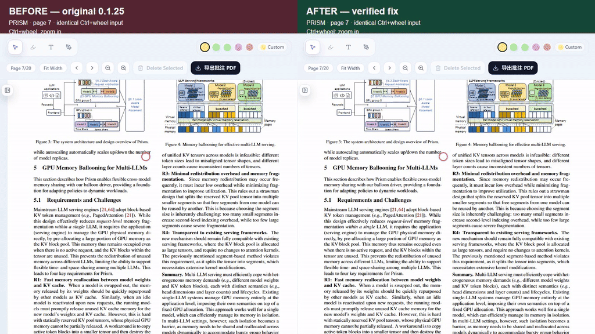

# PDF wheel zoom

Hold Ctrl and use the mouse wheel over the PDF to zoom around the pointer. Position changes apply immediately, without an implicit smooth-scroll animation. Page edges can limit how far the viewer can preserve the pointer position.

During wheel zoom, the viewer reuses the current page image. After 60 ms without another zoom step, PDF.js starts a full-resolution redraw. When a previous zoom layer is available, it remains visible until the replacement canvas finishes rendering. Text can look briefly softer while zooming.

## Before and after

Left: original viewer. Right: fixed viewer. The five-second comparison uses page 7 of *Prism: Cost-Efficient Multi-LLM Serving via GPU Memory Ballooning*, identical viewport sizes and identical Ctrl+wheel input. The red circle marks the pointer position. Recorded with the actual React PDF viewer components in Chromium, rather than a full Electron window capture or a performance benchmark.

For manual regression checks, repeat rapid zoom in/out on later pages and near page boundaries, then verify ordinary scrolling and text selection after drawing finishes. The render handoff depends on PDF.js page-render events and zoom-layer fields; recheck it when upgrading PDF.js.
